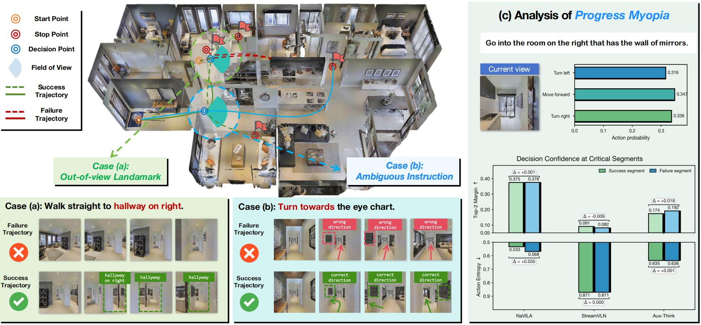

<div align="center">

# Seek Before You Move: Evidence Seeking for Progress Grounding in Vision-Language Navigation

<p align="center" style="margin:1.4em 0 0.8em;">
  <!-- Project Page: wrap this badge in a link once the project website is available. -->
  
  &nbsp;
  <a href="https://arxiv.org/abs/2609.37353"></a>
  &nbsp;
  <a href="https://huggingface.co/datasets/specialsuzuka/SeekVLN-Dataset"></a>
  &nbsp;
  <a href="https://huggingface.co/specialsuzuka/SeekVLN-FRG-SFT"></a>
  &nbsp;
  <a href="https://huggingface.co/specialsuzuka/SeekVLN-C2PO-RFT"></a>
</p>

<p align="center">
  
</p>
</div>

## Introduction

**SeekVLN** addresses *Progress Myopia* through **evidence seeking** and **semantic
progress reasoning**: a unified VLM switches between `NAV` for direct navigation
and `SEEK` for acquiring task-relevant visual evidence before acting.

## Evaluation

This repository releases **inference and evaluation code only**, without training pipelines. Models and data are available in our [Hugging Face collection](https://huggingface.co/collections/specialsuzuka/seekvln-6abcad5a8c398bb292e51252).

### Installation

Use **Linux, an NVIDIA GPU, and Python 3.10**. This repository builds on [VLN-CE](https://github.com/jacobkrantz/VLN-CE), with [Habitat-Lab](https://github.com/facebookresearch/habitat-lab/tree/v0.1.7) and [Habitat-Sim](https://github.com/facebookresearch/habitat-sim/tree/v0.1.7).
Clone the repository and run the commands below from its root directory:

```bash
git clone https://github.com/ZhiminWangSS/SeekVLN.git
cd SeekVLN
```

1. Create conda evaluation environment `seekvln-eval` (Python 3.10).

```bash
conda create -n seekvln-eval python=3.10 -y
conda activate seekvln-eval
```

2. Build Habitat-Sim and Habitat-Lab **v0.1.7** from source.

Install the OpenGL/EGL build dependencies in the same conda environment:

```bash
conda install -c conda-forge libgl-devel libegl-devel libopengl-devel libglx-devel -y
export CMAKE_ARGS="-DCMAKE_PREFIX_PATH=$CONDA_PREFIX"
```

Follow the Habitat installation steps in the [VLN-CE setup guide](https://github.com/jacobkrantz/VLN-CE#setup) using the Python 3.10 environment above. Return to the SeekVLN root directory afterwards.

3. Install PyTorch and SeekVLN from the repository root.

```bash
python -m pip install torch==2.7.1 torchvision==0.22.1 --index-url https://download.pytorch.org/whl/cu126
python -m pip install -e '.[habitat]'
```

The PyTorch command uses CUDA 12.6; choose a compatible build for your driver. Other dependency versions are pinned in `pyproject.toml`. Habitat-Sim/Lab must be installed separately in step 2.

If model loading requires FlashAttention, install a compatible build following the [official instructions](https://github.com/Dao-AILab/flash-attention#installation-and-features).

### Data

Download **R2R-CE / RxR-CE** Val-Unseen annotations, ground truth, and **MP3D** scenes following [VLN-CE](https://github.com/jacobkrantz/VLN-CE#data). Arrange them under the repository root as follows:

```text
data/
├── R2R_VLNCE_v1-3_preprocessed/
│   └── val_unseen/
│       ├── val_unseen.json.gz
│       └── val_unseen_gt.json.gz
├── RxR_VLNCE_v0/
│   └── val_unseen/
│       ├── val_unseen_guide.json.gz
│       └── val_unseen_guide_gt.json.gz
└── scene_datasets/
    └── mp3d/
        └── <scene>/
            └── <scene>.glb

evaluation/data/
└── connectivity_graphs.pkl
```

Copy `connectivity_graphs.pkl` from [VLN-CE](https://github.com/jacobkrantz/VLN-CE/tree/master/data) to`evaluation/data/`. The default configs evaluate 1,839 R2R episodes and 1,223 RxR English-US guide episodes, not the full multilingual RxR set.

Our **Seek 4K** annotations and images are available at [SeekVLN-Dataset](https://huggingface.co/datasets/specialsuzuka/SeekVLN-Dataset). Follow the dataset card to extract the image shards. This dataset is not required for evaluation and does not include Habitat scenes.

### Running Evaluation

1. Download the trained **FRG-SFT** or **C2PO-RFT** checkpoint.

Run either download command below. Login is needed for private or gated access:

```bash
python -m pip install 'huggingface-hub[cli]>=0.26,<1'
huggingface-cli login
huggingface-cli download specialsuzuka/SeekVLN-FRG-SFT --local-dir models/SeekVLN-FRG-SFT
huggingface-cli download specialsuzuka/SeekVLN-C2PO-RFT --local-dir models/SeekVLN-C2PO-RFT
```

Both checkpoints can be loaded directly; no adapter merge is needed.

2. Run evaluation on **R2R-CE**:

```bash
CUDA_VISIBLE_DEVICES=0 bash scripts/eval_r2r.sh \
  --model-path models/SeekVLN-FRG-SFT --output-dir outputs/sft-r2r
```

3. Run evaluation on **RxR-CE** using:

```bash
CUDA_VISIBLE_DEVICES=0 bash scripts/eval_rxr.sh \
  --model-path models/SeekVLN-C2PO-RFT --output-dir outputs/rl-rxr
```

Either model works with both launchers. Set `--model-path` to your checkpoint and
`CUDA_VISIBLE_DEVICES` to an available GPU. Add `--check-only` to check required
paths, or `--episode-limit 2` for a short test.

4. Results are written to `decisions.jsonl` and `summary.json` in `--output-dir`. Use a different directory for each run to avoid overwriting results. These launchers use one GPU; automatic multi-GPU scheduling is not included.

## Citation

Please cite the [SeekVLN paper](https://arxiv.org/abs/2609.37353) when using this code, the checkpoints, or the Seek dataset.

```bibtex
@misc{wang2026seekmoveevidenceseeking,
      title={Seek Before You Move: Evidence Seeking for Progress Grounding in Vision-Language Navigation},
      author={Zhimin Wang and Meiyuan Zhu and Duo Wu and Linjia Kang and Yajun Wang and Yuan Ni and Xiaohang Wang and Tianlu Pan and Jingyan Jiang and Yaowei Wang and Zhi Wang},
      year={2026},
      eprint={2609.37353},
      archivePrefix={arXiv},
      primaryClass={cs.AI},
      url={https://arxiv.org/abs/2609.37353},
}
```

Built on NaVILA/VILA, LLaVA, AuxThink, and VLN-CE/Habitat.
See [THIRD_PARTY_NOTICES.md](THIRD_PARTY_NOTICES.md) for attribution and licenses.
